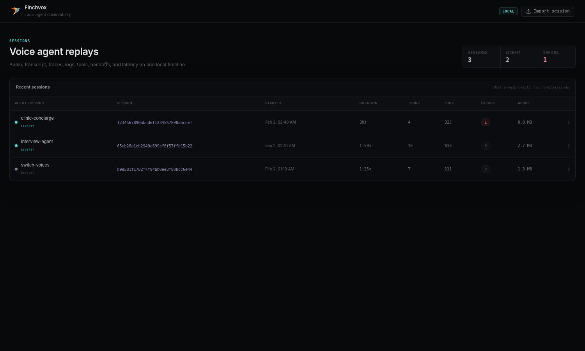
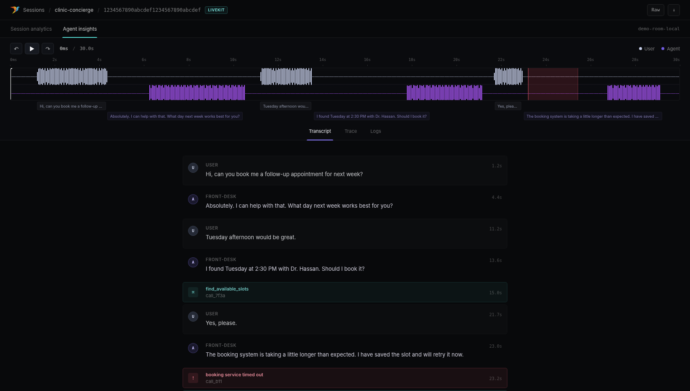
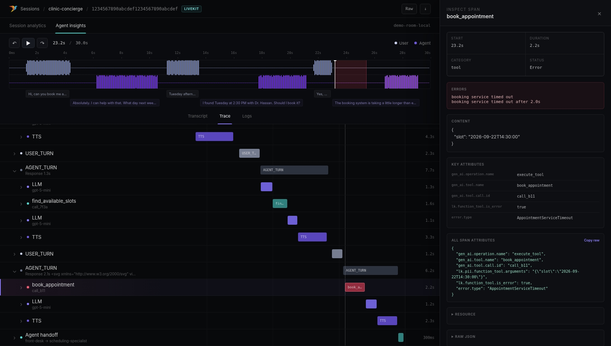

#  Finchvox — local session replay for LiveKit Agents

Finchvox is a local-first voice-agent debugger built around a simple idea: **audio, transcript, traces, logs, tools, handoffs, errors, and latency metrics should all share one session clock**.

This fork makes the LiveKit Agents integration first-class while retaining the original Pipecat support. It is designed for the same debugging workflow you get from a purpose-built agent-insights UI, but with the collector, data, and UI running on your machine.

> Independent project: this fork is not affiliated with or endorsed by LiveKit. It does not ship LiveKit branding or proprietary assets. Finchvox is MIT licensed; see [`LICENSE`](LICENSE).

## UI

### Sessions



### Transcript + synchronized replay



### Hierarchical trace waterfall + inspector



## What this fork adds

- LiveKit Agents OpenTelemetry support, including current `lk.pii.*` content attributes and older stored-trace fallbacks.
- A synchronized **Transcript / Trace / Logs** Agent Insights workflow.
- **Metrics / Environment** session analytics views.
- Hierarchical LiveKit spans for sessions, user/agent turns, STT, LLM, TTS, tools, handoffs, room I/O, and errors.
- Global playhead and time-aligned error/event markers across waveform, transcript, and trace views.
- Right-side inspectors for spans, logs, attributes, errors, timing, content, and raw data.
- LiveKit voice metrics such as E2E latency, transcription delay, end-of-turn delay, queue wait, LLM TTFT, and TTS TTFB when emitted by the SDK.
- Local OTLP log ingestion beside traces.
- Optional LiveKit `SessionReport` ingestion and automatic report-to-trace correlation by job/room identifiers.
- Finalized audio attachment for local playback/waveform replay.
- WAV, MP3, OGG, FLAC, OPUS, WebM, and M4A finalized audio support.
- Fully local UI assets; no Tailwind CDN dependency.
- Anonymous Finchvox product telemetry disabled by default in this fork.
- Pipecat integration retained as an optional extra.

## Architecture

```text
LiveKit Agent
   │
   ├── OTLP traces ────────────────┐
   ├── OTLP logs ─────────────────┤
   │                               ▼
   │                         Finchvox server
   │                       gRPC :4317 / HTTP :3000
   │                               │
   ├── SessionReport ──────────────┤
   └── finalized audio ────────────┤
                                   ▼
                           ~/.finchvox/sessions
                                   │
                                   ▼
                          http://localhost:3000
```

OpenTelemetry provides the trace/latency structure. A `SessionReport` improves the final transcript/event/usage picture. **Audio is separate** because replayable audio is not contained in OTel spans.

## Quick start: LiveKit Agents

### 1. Install

Requires Python 3.12–3.14. The supported voice SDK baselines are LiveKit Agents 1.8.9+ and Pipecat 1.14+.

From this repository:

```bash
uv sync --extra livekit
```

Or:

```bash
pip install -e ".[livekit]"
```

The LiveKit extra no longer requires the Pipecat runtime. If you also use Pipecat:

```bash
uv sync --extra livekit --extra pipecat
```

### 2. Start Finchvox

```bash
uv run finchvox start
```

Open:

```text
http://localhost:3000
```

By default:

- UI / HTTP API: `localhost:3000`
- OTLP/gRPC traces + logs: `localhost:4317`
- data directory: `~/.finchvox`
- bind address: `127.0.0.1` (local machine only)
- largest session zip the UI accepts: 1024 MB

Use a project-local data directory if preferred:

```bash
uv run finchvox start --data-dir ./.finchvox-data
```

Change the session upload limit if you need to import larger sessions. Unzipped limits scale with it: 10× this size in total, and ¼ of it for JSON and JSONL files, which are loaded into memory.

```bash
uv run finchvox start --max-upload-mb 4096
```

Finchvox binds to loopback by default. If another container or machine must reach it, opt in explicitly with `--host 0.0.0.0` and protect the port at the network layer.

Or run it in Docker, with the same ports and sessions kept in a Docker volume:

```bash
docker compose up -d --build
```

See [`docs/DOCKER.md`](docs/DOCKER.md) for settings, backups and Windows notes.

### 3. Add two lines to the agent

```python
import finchvox
from finchvox.livekit import on_session_end

finchvox.init_livekit(service_name="my-livekit-agent")   # before the session starts

@server.rtc_session(on_session_end=on_session_end)       # your existing decorator
async def entrypoint(ctx):
    ...
```

The first line sends traces and logs to Finchvox while the call runs. The second sends LiveKit's session report and recording when it ends. It also flushes everything at the right moments, and only logs a problem, never raising it, so Finchvox cannot break your agent's shutdown. LiveKit Cloud keeps receiving its own copy.

If you already have an `on_session_end`, call Finchvox from it instead:

```python
from finchvox.livekit import finalize_session

async def on_session_end(ctx):
    ...  # your own code
    await finalize_session(ctx)
```

`finalize_session` also accepts `audio_path=...` for a recording of your own, and `endpoint=...`. By default it uploads to port 3000 on the host given to `init_livekit()`.

## Full LiveKit setup guide

For a complete copy/paste integration, local-only vs LiveKit Cloud behavior, audio recording, Docker networking, privacy, troubleshooting, and a full agent example, read:

**[`docs/LIVEKIT_LOCAL_SETUP.md`](docs/LIVEKIT_LOCAL_SETUP.md)**

A runnable example lives in:

**[`examples/livekit/agent.py`](examples/livekit/agent.py)**

## Privacy and local-only behavior

Finchvox's own anonymous product telemetry is disabled by default in this fork.

The more important setting is LiveKit trace content:

```python
finchvox.init_livekit(allow_pii=True)
```

`allow_pii=True` lets Finchvox receive conversational content used for the local replay, including transcripts, model responses, and tool payloads when LiveKit emits them. Treat the local Finchvox data directory as sensitive.

Use:

```python
finchvox.init_livekit(allow_pii=False)
```

for structural/timing spans without LiveKit's PII/content attributes. This setting does not redact separately exported logs, uploaded SessionReports, or recordings.

### If you connect to LiveKit Cloud

Your **custom** OTel exporter still sends its copy of spans to Finchvox, but LiveKit's own `record`/observability settings are separate. Do not assume `record=True` is local-only when connected to LiveKit Cloud.

If you require local-only Finchvox telemetry while using LiveKit Cloud for media, configure LiveKit recording/observability accordingly and attach audio to Finchvox from your own local recorder if you need waveform playback. The full guide explains the tradeoff.

### Fully self-hosted LiveKit

`ctx.make_session_report()` is generated in the agent process and works with self-hosted LiveKit. The custom OTel path to Finchvox is also independent of LiveKit Cloud observability.

## What Finchvox understands from LiveKit

Typical hierarchy:

```text
agent_session
├── user_turn
│   ├── stt_node / stt_request
│   └── eou_wait
├── agent_turn
│   ├── llm_node / llm_request
│   ├── function_tool / execute_tool
│   └── tts_node / tts_request
├── update_agent           # handoff
└── room_connect / room_io
```

The adapter recognizes current and legacy LiveKit attributes for:

- transcript/response content,
- tool arguments and results,
- agent labels and handoffs,
- speech/generation IDs,
- interruption state,
- room/job/participant context,
- model/provider names,
- input/output token counts,
- E2E and pipeline latency,
- exceptions and errors.

## Local logs

`capture_logs=True` installs an OpenTelemetry logging handler pointed at Finchvox's local collector. Python logs emitted with active LiveKit context can retain trace/span correlation and appear in the session Logs view.

Disable local OTLP logs without disabling traces:

```python
finchvox.init_livekit(capture_logs=False)
```

## Audio

OTLP spans do not contain replayable audio. To show the waveform/playback experience, attach a finalized recording.

`on_session_end` uploads the recording LiveKit made, when the session report names one (`audio_recording_path`). To upload a recording of your own instead:

```python
await finalize_session(ctx, audio_path="./recordings/session.ogg")
```

Supported finalized formats:

```text
.wav  .mp3  .ogg  .flac  .opus  .webm  .m4a
```

## Pipecat

The original Finchvox workflow remains available as an optional extra:

```bash
uv sync --extra pipecat
```

```python
import finchvox
from finchvox import FinchvoxProcessor

finchvox.init(service_name="my-pipecat-app")
```

Use `FinchvoxProcessor()` in the Pipecat pipeline as in the upstream project.

## Development

See [`docs/DEVELOPMENT.md`](docs/DEVELOPMENT.md).

Core checks:

```bash
PYTHONPATH=src pytest -q
node --check ui/js/session_detail.js
node --check ui/js/logs_view.js
node --check ui/js/sessions_list.js
PYTHONPATH=src python -m compileall -q src tests examples/livekit
```

Background and fork history are in [`docs/FORK.md`](docs/FORK.md); research and design reviews are in [`docs/research/`](docs/research/README.md).

## Known limitations

- Audio must be supplied separately from OTel.
- Report auto-correlation needs a completed span carrying a matching LiveKit job/room identifier; passing an explicit trace ID remains the fallback.
- Logs emitted without usable trace context may not be assignable to a particular session.
- Realtime-model sessions expose a different set of per-turn latency fields than STT → LLM → TTS pipelines.
- This is a development-oriented local observability tool. Add authentication/TLS before exposing it on an untrusted network.

## Upstream and license

This fork is based on the MIT-licensed [Finchvox](https://github.com/finchvox/finchvox) project and its LiveKit-oriented work. Keep the upstream copyright/license notice when redistributing modified versions.

See [`LICENSE`](LICENSE).
